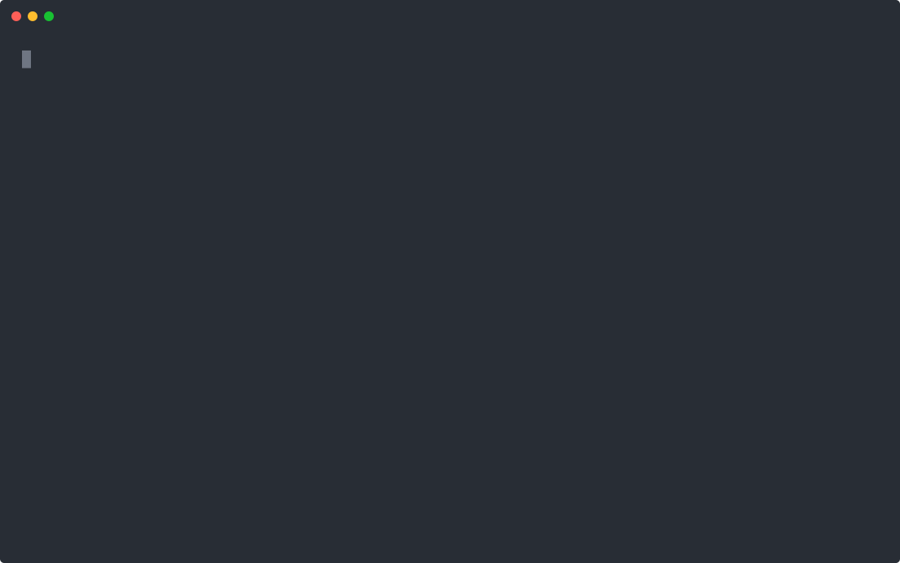
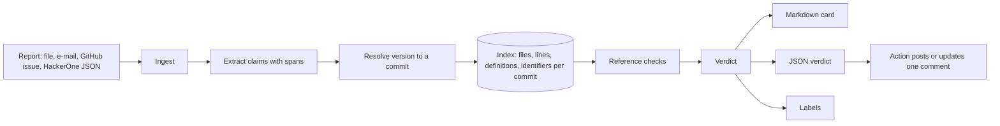
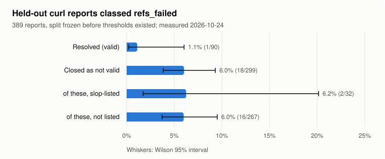

# sloptriage

Check a bug or security report against the code before you spend an hour on it: every file, function,
line, stack frame and quoted snippet the report cites is verified at the version it names. No LLM.
CLI and GitHub Action.

[](https://github.com/B0yko/sloptriage/actions/workflows/ci.yml)
[](https://github.com/B0yko/sloptriage/releases)
[](LICENSE)

<!-- headline:start -->
On 299 held-out curl reports that were closed as not applicable, informative or spam, sloptriage found cited references that do not exist in curl's code (at the version the report names, or the default branch on the report date when it names none) in 18 (6.0%, 95% CI 3.8–9.3%); it flagged 1 of 90 resolved reports. When it flags a report, the report was closed as not valid 18 times out of 19.
<!-- headline:end -->
([How this was measured](#results).)



```bash
uvx --from git+https://github.com/B0yko/sloptriage sloptriage demo
```

The demo runs offline on two small bundled projects and 60 labelled reports and prints its result in a
few seconds.

## Why

Maintainers receive reports that read well and cite code that does not exist: functions nobody wrote,
line numbers past the end of the file, stack traces whose frames sit in the wrong function, "quoted"
code that was never in the repository. Each one takes time to refute.
[curl ended its bug bounty](https://daniel.haxx.se/blog/2026/01/26/the-end-of-the-curl-bug-bounty/)
on 2026-01-31 and later [paused report intake for a month](https://daniel.haxx.se/blog/2026/06/15/curl-summer-of-bliss/);
Daniel Stenberg keeps a [public list of such reports](https://gist.github.com/bagder/07f7581f6e3d78ef37dfbfc81fd1d1cd).
Seth Larson described the pattern in
["New era of slop security reports for open source"](https://sethmlarson.dev/slop-security-reports) (2024),
[Django's security policy](https://docs.djangoproject.com/en/dev/internals/security/#ai-assisted-reports)
asks reporters to avoid fabricated code and references, and the Linux kernel documents
[responsible use of AI to find bugs](https://docs.kernel.org/process/security-bugs.html#responsible-use-of-ai-to-find-bugs).

sloptriage does the first, mechanical part of triage: it treats what a report cites as claims and
checks each one against the repository. It reports what it checked and what it found. It never closes,
deletes or rejects anything, and it never says who or what wrote a report.

## Quickstart (under 5 minutes)

Needs Python 3.11+ (through [uv](https://docs.astral.sh/uv/)) and git.

```bash
# 1. The offline demo: two small projects with known bugs and 60 labelled reports
uvx --from git+https://github.com/B0yko/sloptriage sloptriage demo
uvx --from git+https://github.com/B0yko/sloptriage sloptriage demo --show 32   # one full result

# 2. Your own repository and a report saved as a file
cd path/to/your/repo
uvx --from git+https://github.com/B0yko/sloptriage sloptriage init       # writes .sloptriage.yml
uvx --from git+https://github.com/B0yko/sloptriage sloptriage check report.md

# 3. A remote repository (bare-cloned into ~/.cache/sloptriage) and a GitHub issue
GITHUB_TOKEN=... uvx --from git+https://github.com/B0yko/sloptriage \
  sloptriage check owner/repo#123 --repo https://github.com/owner/repo --format md
```

Or with Docker: `docker run --rm ghcr.io/b0yko/sloptriage:0.1.0 demo`.

`check` prints text by default; `--format md` gives the comment card and `--format json` the verdict
validated against [`schemas/verdict-v1.json`](schemas/verdict-v1.json). `--fail-on refs_failed` exits 1
for that class. Exit code 2 means a usage or configuration error, 3 an infrastructure error (git or
network).

## For maintainers: the GitHub Action

Copy [`examples/workflows/triage-issues.yml`](examples/workflows/triage-issues.yml) into
`.github/workflows/`:

```yaml
name: Triage issues

on:
  issues:
    types: [opened, edited]

permissions:
  contents: read

concurrency:
  group: sloptriage-${{ github.event.issue.number }}
  cancel-in-progress: true

jobs:
  check:
    runs-on: ubuntu-latest
    permissions:
      contents: read
    steps:
      - uses: actions/checkout@3d3c42e5aac5ba805825da76410c181273ba90b1 # v7.0.1
        with:
          fetch-depth: 0
          persist-credentials: false
      - uses: B0yko/sloptriage@v0.1.0
        with:
          mode: check
      - uses: actions/upload-artifact@cf430e030ddbb5b0abf93d22962f4752f3646cd9 # v7.0.2
        with:
          name: verdict
          path: verdict.json
          retention-days: 7

  report:
    needs: check
    runs-on: ubuntu-latest
    permissions:
      issues: write
    steps:
      - uses: actions/download-artifact@9000827ccba6bdab643e8b6fd33ac0654aef8333 # v8.0.2
        with:
          name: verdict
      - uses: B0yko/sloptriage@v0.1.0
        with:
          mode: post
          token: ${{ github.token }}
```

- **`check`** has read-only access and no secrets. It reads the issue only from the event payload file
  (`$GITHUB_EVENT_PATH`), never from an expression, and writes `verdict.json`. It renders nothing.
- **`report`** has `issues: write` and nothing else. It validates the downloaded verdict against the
  schema, renders the card from its fields with every report-derived string escaped, and posts or
  updates one comment marked `<!-- sloptriage -->`, so edits never duplicate it. It does not check out
  the repository and never runs anything from the issue.
- The action runs sloptriage from its own source at the pinned commit with the locked dependencies
  (`uv run --locked`).
- **Labels** (configurable): `triage:refs-verified`, `triage:refs-thin`, `triage:refs-mixed`,
  `triage:refs-failed`, `triage:needs-version`, `triage:needs-poc`.
- **Comment policy:** by default sloptriage always labels and comments only for `refs_failed`,
  `refs_mixed`, `needs_version` and `needs_poc`. Set `comment.mode` to `label`, `comment` or `both`, and
  `comment.when` to the classes that get a comment (`always` for every report).

There is no workflow for private vulnerability reports, on purpose: workflows cannot be triggered by
them, `GITHUB_TOKEN` cannot read draft advisories, and the logs and artifacts of a public repository are
world-readable. Run `sloptriage check --advisory OWNER/REPO/GHSA-xxxx-xxxx-xxxx` on your own machine
instead, with a fine-grained token that has "Repository security advisories: read"; the result goes to
your terminal only. See [docs/action.md](docs/action.md).

## For reporters: check before you send

```bash
uvx --from git+https://github.com/B0yko/sloptriage sloptriage preflight my-report.md --repo https://github.com/owner/repo
```

`preflight` runs the same checks and prints a checklist: names and line numbers that do not match the
version you name, a missing version, a missing reproducer. It helps anyone who wants their report read,
including people who drafted it with an AI tool.

## How it works



1. **Ingest.** Markdown or text, `.eml` (text parts become the body, attachments are kept), a GitHub issue
   (`owner/repo#N` or an Actions event payload) or a public HackerOne report JSON. HTML is converted to
   text without rendering or fetching anything.
2. **Extract.** A deterministic extractor finds paths, symbols, line numbers, versions and commit SHAs,
   stack frames (ASan, UBSan, LSan, MSan, TSan, Valgrind, gdb, lldb, Python, Go, Rust), quoted code, PoC
   blocks, CVE and CWE ids and the claimed crash type, each with a character span and a confidence.
   `name()` in backticks is high confidence; a bare word is medium. Only high-confidence claims can fail
   a report. Keywords, standard-library and libc/POSIX names, common English words and names a PoC defines
   itself are never claims about the project.
3. **Resolve the version.** `curl 8.10.1` becomes `curl-8_10_1` through configurable tag patterns. No
   version, or "master", means the default branch as of the report date. A version that was never
   tagged is reported with the nearest tags.
4. **Index.** Straight from git objects (`git ls-tree`, `git cat-file --batch`), so bare clones work.
   Definitions come from per-language tree-sitter grammars (C, C++, Python, JavaScript, TypeScript, Go,
   Rust) plus a brace-matching pass for C functions inside `#if` branches. Blob analysis is cached once
   per content hash in one SQLite file per repository, so a second tag only parses what changed.
5. **Check.** Each claim gets a status and a permalink to the exact lines:
   - paths: found, found at another version, not found;
   - symbols: defined, used but not defined here, defined at another version, external, not found;
   - lines: in range, blank or comment, past the end of the file;
   - frames ("in X at file:line"): consistent, line outside the function, function not in that file;
   - frame chains: whether each caller mentions its callee (informational);
   - quotes: exact, approximate (at least 85% of lines found in order), not found.

   A citation that fails at the stated version but matches another indexed release counts as "another
   version": a soft finding that is shown and lowers the verified share, never a hard failure. A name that
   is used in the project but defined elsewhere (a system or library function) counts as verified.
6. **Classify.** `refs_failed` when at least 2 high-confidence citations fail, or 1 fails and fewer than
   70% of the checked citations verify. Padding a report with real references cannot rescue fabricated
   ones. `refs_verified` (everything checks out, at least 3 citations), `refs_thin` (everything checks
   out, fewer than 3), `refs_mixed`, `refs_none` (nothing checkable). The thresholds were chosen on the
   dev split only ([ADR 0002](docs/adr/0002-thresholds-chosen-on-dev-split.md)).

`refs_verified` means the citations exist. It does not mean the vulnerability is real.

More in [docs/how-it-works.md](docs/how-it-works.md).

## Configuration

`.sloptriage.yml` in the repository root (`sloptriage init` writes a starter file). An example with
every section (the benchmark's own curl config is [`examples/curl/.sloptriage.yml`](examples/curl/.sloptriage.yml)):

```yaml
version: 1
project:
  name: curl
  aliases: [libcurl]
  repository: https://github.com/curl/curl
  binaries: [curl]
version_tags: [curl]          # presets: v, plain, curl, release, underscore, name-dash; or patterns
languages: [c]
paths:
  ignore: ["tests/data/**"]
symbols:
  external: ["SSL_*", "nghttp2_*"]
thresholds:
  hard_fail_min: 2
  min_verified_share: 0.7
  min_verified_claims: 3
labels:
  refs_failed: "triage:refs-failed"
comment:
  mode: both                  # label, comment or both
  when: [refs_failed, refs_mixed, needs_version, needs_poc]
cves_file: docs/cves.txt      # optional list of the project's own CVE ids
```

Every validation error names the file and the key path, and unknown keys are errors. Full reference:
[docs/config.md](docs/config.md). Example configs: [curl](examples/curl/.sloptriage.yml), a
[CMake C project](examples/parsekit/.sloptriage.yml), a [Python package](examples/kvconf/.sloptriage.yml).

## Results

<picture>
  <source media="(prefers-color-scheme: dark)" srcset="docs/img/heldout-dark.svg">
  
</picture>

**Data.** curl discloses every report sent to its HackerOne programme, valid or not
([policy](https://curl.se/dev/vuln-disclosure.html)). On 2026-10-23, HackerOne's public hacktivity search
listed 658 disclosed curl reports; each one's public JSON was fetched once (658 requests, at most one per
second). Labels: resolved = valid; not-applicable, informative or spam = invalid; 9 duplicates excluded.
The reports were split 40% dev / 60% held-out, stratified by label and by disclosure before or after
2023-01-01, and the split was committed (`c33cdd9`, "bench: freeze split") before the classifier had any
thresholds.

**Held-out evaluations: two.** The first run (code at `2b38a84`) classed 10 of 90 valid reports as
`refs_failed`. The thresholds were not changed. The causes were defect classes already seen on the dev
split: bare backticked identifiers that are reporters' own labels or third-party constants, a system
path (`/usr/include/...`) mapped onto a project directory, and frames from an older release. One fix
(`e036d44`) addressed them; the dev split stayed at 0 of 60 false flags, and the second held-out run
produced the numbers below. They are therefore not a pristine first-look estimate. The rows of the first
run are in [`bench/results/rows-heldout-run1-2026-10-24.json`](bench/results/rows-heldout-run1-2026-10-24.json).

<details>
<summary>All result tables</summary>

<!-- results:start -->
Measured on 2026-10-24 on a Mac Studio M4 Max, 128 GB with `sloptriage 0.1.0`; split frozen in commit `c33cdd9`; thresholds `hard_fail_min = 2`, `min_verified_share = 0.7` (chosen on the dev split only). Intervals are Wilson 95% intervals.

**Held-out split: reports classed `refs_failed`**

| Group | Classed `refs_failed` |
|---|---|
| Resolved (valid) | 1/90 (1.1%, 0.2–6.0%) |
| Not applicable, informative or spam (invalid) | 18/299 (6.0%, 3.8–9.3%) |
| Invalid, listed in the curl slop gist | 2/32 (6.2%, 1.7–20.1%) |
| Invalid, not listed | 16/267 (6.0%, 3.7–9.5%) |
| Valid, disclosed before 2023 | 0/27 (0.0%, 0.0–12.5%) |
| Invalid, disclosed before 2023 | 1/34 (2.9%, 0.5–14.9%) |
| Valid, disclosed 2023 or later | 1/63 (1.6%, 0.3–8.5%) |
| Invalid, disclosed 2023 or later | 17/265 (6.4%, 4.0–10.0%) |

Precision for invalid: 18/19 (94.7%, 75.4–99.1%). Coverage (at least one checkable high-confidence claim): 232/299 (77.6%, 72.5–82.0%) of invalid and 59/90 (65.6%, 55.3–74.6%) of valid reports. Dev split for comparison: 0/60 (0.0%, 0.0–6.0%) valid and 16/200 (8.0%, 5.0–12.6%) invalid reports classed `refs_failed`. Reports that named no usable version were checked at the default branch as of the report date: 238/389 (61.2%, 56.3–65.9%) of held-out reports, and 9/19 (47.4%, 27.3–68.3%) of the flagged ones.

**Per check, held-out split: share of reports with at least one high-confidence citation of**

| Citation | Invalid reports | Valid reports |
|---|---|---|
| a function, macro or type that is not defined | 15/299 (5.0%, 3.1–8.1%) | 0/90 (0.0%, 0.0–4.1%) |
| a file that does not exist | 5/299 (1.7%, 0.7–3.9%) | 2/90 (2.2%, 0.6–7.7%) |
| a line past the end of its file | 1/299 (0.3%, 0.1–1.9%) | 1/90 (1.1%, 0.2–6.0%) |
| a stack frame whose line is outside the named function | 0/299 (0.0%, 0.0–1.3%) | 0/90 (0.0%, 0.0–4.1%) |
| quoted code that does not appear in the project | 12/299 (4.0%, 2.3–6.9%) | 4/90 (4.4%, 1.7–10.9%) |

**Synthetic set (consistency with the specification, not a measure of real-world accuracy)**

| Failure mode | Reports | Classed `refs_failed` |
|---|---|---|
| `fabricated_quote` | 4 | 4 |
| `fabricated_trace` | 4 | 4 |
| `frame_mismatch` | 3 | 3 |
| `line_blank_or_comment` | 2 | 0 |
| `line_out_of_range` | 4 | 4 |
| `no_poc` | 1 | 0 |
| `no_references` | 2 | 0 |
| `nonexistent_file` | 8 | 8 |
| `nonexistent_function` | 19 | 19 |
| `other_library` | 2 | 2 |
| `padded` | 4 | 4 |
| `poc_does_not_compile` | 2 | 2 |
| `poc_does_not_reproduce` | 1 | 0 |
| `poc_no_library_call` | 2 | 0 |
| `poc_own_buffer` | 2 | 0 |
| `stale_reference` | 1 | 1 |
| `version_never_released` | 3 | 2 |
| valid reports | 20 | 0 |

Reports whose only fault is the PoC (it overflows its own buffer, never calls the library or uses a normal
input) cite code that exists, so the reference check does not flag them; PoCs are not run in v0.1.0.

**Latency**

Cold index of `curl-8_17_0`: 3.3 s. Checking each of the 389 held-out reports one at a time against an indexed ref: p50 0.30 s, p95 3.21 s (Mac Studio M4 Max, 128 GB, 2026-10-24).

**Every valid held-out report classed `refs_failed`**

- [#3751712](https://hackerone.com/reports/3751712), checked at `507cf6a13d`: 2 hard failures (1 × quoted code that does not appear in the project, 1 × a file that does not exist) against 1 verified of 3 checked.
<!-- results:end -->

</details>

Reproduce: `uv run sloptriage bench fetch` (downloads the report JSON into your cache),
`uv run sloptriage bench run --split heldout`, `uv run sloptriage bench report <rows files>`,
`uv run python eval/latency.py`, then `uv run python scripts/render_results.py`. Details:
[docs/bench.md](docs/bench.md).

**Caveats.** This is one project's corpus. The labels are noisy: "informative" includes real bugs that
were not security issues, and "not applicable" does not mean a report was written by AI. A careful
author with correct references passes the reference check; it checks references, not truth. Most
low-quality curl reports cite code that does exist, which is why recall is low.

## Security model and what is stored

- There is no LLM, so report text cannot prompt-inject the triager, and every result is reproducible.
- Report text is data. In the Action it is read from the event file, never interpolated into a shell;
  the card shows report-derived strings only as escaped inline code, with no HTML, images or links
  except permalinks into the project's own repository, and with `@mentions` neutralised.
- `--repo URL` makes a bare clone in `${XDG_CACHE_HOME:-~/.cache}/sloptriage/repos/`. Nothing is ever
  cloned from a URL found in a report.
- The benchmark stores report IDs and URLs, the HackerOne substate, slop-list membership, the
  disclosure date, SHA-256 hashes of each fetched JSON and its body, and derived counts and classes. It
  never stores report text, titles, reporter names or excerpts; a test checks that the manifest schema
  has no free-text field. `bench fetch` downloads the reports to your own machine. The per-report rows
  list what the tool found for each public report ID; they are not a judgement of the people who wrote
  the reports.

More in [docs/security-model.md](docs/security-model.md).

## Benchmark sources and terms

- Report JSON: `https://hackerone.com/reports/<id>.json`, public, no login. On 2026-10-23
  [robots.txt](https://hackerone.com/robots.txt) contained only a sitemap line, and HackerOne's
  [General](https://www.hackerone.com/terms/general) and
  [Community Member](https://www.hackerone.com/terms/community) terms (effective 2026-05-11) contained no
  clause about automated access. The fetcher sends a User-Agent naming this project, makes at most one
  request per second, honours `Retry-After` and stops after repeated errors.
- Report IDs: the public hacktivity search on hackerone.com (`scripts/enumerate_hackerone.py`).
- Slop-list membership: [the curl maintainers' gist](https://gist.github.com/bagder/07f7581f6e3d78ef37dfbfc81fd1d1cd),
  revision `95a02e1`.
- Code: curl's public git repository, cloned into the cache and never committed.
- Synthetic set: `demo/`, written for this project (Apache-2.0).

## Limitations

- **It checks citations, not vulnerabilities.** A report with correct references and a false claim passes.
- **A report without concrete references cannot be checked** (`refs_none`).
- **PoCs are not run.** v0.1.0 checks references only. A PoC that overflows its own buffer or never calls
  the library is not detected. The verdict schema keeps a `reproduction` field for later.
- **Macros, inlining and function pointers** make frame chains unreliable, so chains are informational.
- **Many reports name no version.** 61% of the held-out curl reports named no usable version and were
  checked at the default branch as of the report date (9 of the 19 flagged ones). A report that read
  code from another version can then look wrong; citations that match any indexed release are not counted
  as failures, which limits but does not remove this.
- **One benchmark project.** No second project with publicly disclosed, outcome-labelled reports was
  found in time.
- **Recall is low on real reports**, because most of them cite code that exists.
- Windows is not supported; macOS and Linux are.

## Alternatives

Described from their own READMEs or pages, checked 2026-10-23:

- [SlopGuard](https://github.com/foudreeeee/SlopGuard) (MIT): static file, line and symbol existence
  checks, duplicate and CWE checks, a confidence score and an optional LLM pass.
- [Substantiate](https://github.com/Dgotlieb/substantiate) (Apache-2.0): checks that files, lines,
  functions, tags and commits cited in an issue or report exist, deterministically and without a model;
  CVE ids are checked in an opt-in online tier.
- [triage0](https://github.com/nomanSanjari/triage0): extracts claims and checks them in a container
  against git, AST and compiler output; early stage.
- [SlopGate](https://github.com/sleepy-ujjawal/slopgate): an agent that tries to reproduce a report in a
  sandbox and writes a triage memo; uses an LLM.
- [honeyslop](https://github.com/gadievron/honeyslop) (MIT): decoy code canaries that make scanner
  reports identify themselves.
- [repro-required-gate](https://github.com/dtaylor2698/repro-required-gate) (MIT): fails issues that lack
  steps, expected, actual and reproduction headings; checks form, not code.
- [HackerOne Hai Triage](https://www.hackerone.com/platform/triage): commercial, AI agents plus human
  analysts.
- Elastic's [internal LLM triage with Docker reproduction](https://www.elastic.co/security-labs/blog/ai-vulnerability-triage-bug-bounty-hackerone)
  (2026-08-04): described in a blog post, not released.
- GitHub has [announced plans](https://github.com/orgs/community/discussions/189802) for AI-assisted
  triage of private vulnerability reports; not shipped as of 2026-10-23.

## Roadmap

- PoC reproduction in a sandbox, behind an opt-in flag.
- A second benchmark project.
- Duplicate detection across reports.
- PyPI release (`pip install sloptriage`).

## Related

Same "claims versus evidence" idea, other domains: [agent-claimcheck](https://github.com/B0yko/agent-claimcheck),
[proof-of-done](https://github.com/B0yko/proof-of-done).

## License

Apache-2.0. See [LICENSE](LICENSE) and [NOTICE](NOTICE). Copyright 2026 Andrii Boiko.
