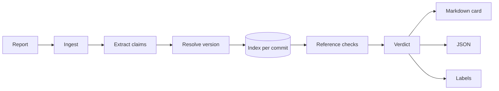

# How it works



## Claims

`extract.py` is deterministic: regular expressions plus a few structural rules, no model. Each claim has
a kind, a value, a character span in the report, a confidence (`high` or `medium`) and the source that
produced it (backticks, prose, a permalink, a stack frame).

| Kind | Examples | High confidence when |
|---|---|---|
| `path` | `lib/http.c`, `/home/u/curl/lib/http.c`, GitHub `blob` links | it has a directory part |
| `symbol` | `` `Curl_parse()` ``, "the function `x`", `foo()` in prose | written as a call in backticks; in prose only snake_case or camelCase calls |
| `line` | `lib/http.c:812`, "line 40 of lib/url.c", `#L10-L20`, "Lines 741, 773 and 804" after a `File:` line | path and line are given together |
| `frame` | ASan/UBSan/LSan/MSan/TSan, Valgrind, gdb `bt`, lldb, Python, Go, Rust traces; "in X at file:line" | file, line and function are all present |
| `quote` | a fenced block introduced as code from a named project file | the paragraph before it names a project file or calls it the code in/from the project |
| `poc` | fenced blocks with `main(`, a shebang, a labelled reproducer, a command that runs the project's binaries, a base64 or hex input | always (not checked against references) |
| `version` | `curl 8.10.1`, `libcurl/7.88.0`, `curl-8_4_0`, `v2.3.0`, a commit SHA after "commit" | near the project's name or aliases |
| `cve`, `cwe` | `CVE-2023-38545`, `CWE-122` | format only |
| `sanitizer_claim` | "heap-buffer-overflow", "use-after-free" | taken from a sanitizer header |

Never claims about the project: language keywords, names in the bundled standard-library and libc/POSIX
lists, common English words, product names, and names a PoC in the same report defines itself. Names of
well-known third-party libraries (OpenSSL, nghttp2, libssh2, zlib, Apple Security, Windows SSPI, …) and
`symbols.external` patterns are checked but reported as `external`, which is neutral.

A suggested fix ("Suggested fix:", "should be", "patch") is not a quote, and code introduced as a
reproducer is a PoC, not a quote.

## Version resolution

1. The first high-confidence version claim that maps to a tag through `version_tags` wins. A commit SHA
   the report names is used directly.
2. Development versions (`8.11.0-DEV`), "latest", "master" or no version: the default branch as of the
   report's `created_at` (`git rev-list -1 --before`), else its head. The result says the version was
   assumed.
3. A version that is not tagged is itself a finding, with the nearest tags.

Alternate refs are tried only after a citation fails at the primary ref: the default branch as of the
report date, the newest release tag before that date, and the default branch head. The index can also
hold one tag per minor release (`sloptriage index --history`); a citation that matches any indexed
version counts as "another version", never as a failure.

## Index

`git ls-tree -r` lists the commit's files and one long-lived `git cat-file --batch` reads the blobs, so no
working tree is needed and bare clones work. For each new blob: line count, definitions with line spans
(tree-sitter, per-language wheels) and the identifiers it contains. Blob results are keyed by blob SHA in
one SQLite file per repository; a commit adds only its tree listing. Indexing a curl tag from scratch takes
about 3 s on a Mac Studio M4 Max.

C is parsed without a preprocessor, so a function whose signature or braces sit in `#if` branches can
come out of tree-sitter as an error node. A second pass blanks comments, strings and every non-first
`#if` branch, then matches braces; both sets of spans are kept, which only makes span checks more
lenient.

## Checks and statuses

| Check | Statuses | Hard failure (high confidence only) |
|---|---|---|
| path | `found`, `found_moved`, `not_found`, `outside_project`, `other_repository` | `not_found` |
| symbol | `defined`, `referenced_only`, `defined_at_other_version`, `external`, `defined_by_poc`, `not_found` | `not_found` |
| line | `in_range`, `blank_or_comment`, `in_range_at_other_version`, `out_of_range` | `out_of_range` |
| frame | `consistent`, `consistent_at_other_version`, `outside_function`, `function_not_in_file`, `outside_project` | `outside_function`, `function_not_in_file` |
| frame chain | `call_seen`, `call_not_seen` | never |
| quote | `exact`, `approximate`, `found_at_other_version`, `not_found`, `too_short` | `not_found` |
| PoC | `calls_project`, `no_project_reference` | never |

Frames in sanitizer runtimes, libc, system paths, the reporter's own harness (unresolved frames below
the deepest resolved project frame) and files named like reproducers (`poc.c`, `exploit.py`) are
`outside_project`.

A quote is compared after removing comments and whitespace. Abbreviations (`...` lines) split it into
excerpts; each excerpt is located on its own, and the quote counts as found when at least 85% of its
significant lines appear in order inside one window of a candidate file. Candidates are the file the
report names plus the files that share the quote's rarest identifiers.

## Classification

```
refs_failed    hard >= hard_fail_min, or hard >= 1 and verified/checked < min_verified_share
refs_verified  no hard or soft failures and verified >= min_verified_claims
refs_thin      no hard or soft failures and verified < min_verified_claims
refs_mixed     anything else with checkable claims
refs_none      nothing checkable
```

Counts are per high-confidence claim of kind path, symbol, line, frame or quote; a claim's worst finding
decides. Defaults: `hard_fail_min = 2`, `min_verified_share = 0.7`, `min_verified_claims = 3`.
